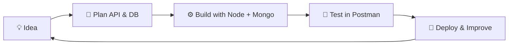

<!-- Replace YOUR_USERNAME, YOUR_LINKEDIN, YOUR_EMAIL, YOUR_PORTFOLIO_LINK -->

 **Hey there, I'm Naveeno!**

  

## 👨‍💻 About Me

<table>
<tr>
<td width="60%">

- 🎓 Final-year **BCA** student at **Alpha Arts and Science College**, Chennai
- 🔭 Building **REST APIs**, **AI-integrated apps** and **interactive web experiences**
- 🌱 Currently learning: **Backend architecture, JWT security, AI APIs, System Design**
- 🏅 Certified by **IBM**, **MongoDB** and **Naan Mudhalvan**
- 💬 Ask me about: **Node.js, Express, MongoDB, JavaScript, Python**
- 🎯 Goal: **Become a Full-Stack / Backend Engineer**
- ⚡ Fun fact: I build projects that stand out, not tutorial clones

</td>
<td width="40%" align="center">

</td>
</tr>
</table>

## 🛠️ Tech Stack

  

## 🚀 Featured Projects

 

| | Project | What it does | Tech |
|---|---------|--------------|------|
| 🏋️ | **FitSense** | AI fitness API that returns personalised workout plans using Google Gemini | `Node.js` `Express` `MongoDB` `Gemini AI` |
| 🎯 | **MicroGoals API** | Secure goal-management REST API with JWT auth and protected routes | `Node.js` `Express` `MongoDB` `JWT` |
| ⚛️ | **Elementa** | Interactive periodic table with charts and 3D visuals | `HTML` `CSS` `JS` `Chart.js` `Three.js` |
| 💱 | **Alphagenzz** | Foreign currency money-transfer web app (internship project) | `Web App` `Currency Transfer` |

## 🧭 How I Build

## 📊 GitHub Analytics

 

 

## 📈 Contribution Graph

## 🐍 Contribution Snake

## 🏆 Certifications

## 🗺️ 2026 Roadmap

- [x] Build REST APIs with Node.js, Express and MongoDB
- [x] Integrate an AI API (Google Gemini)
- [x] Ship an interactive frontend project (Elementa)
- [ ] Deploy all projects with live demo links
- [ ] Learn TypeScript and React
- [ ] Learn Docker and CI/CD basics
- [ ] Land a developer role / internship

## 💬 Quote of the Day

## 🤝 Let's Connect

**Open to internships, collaborations and freelance projects.**

⭐ *If you like my work, drop a star on my repos!* ⭐

